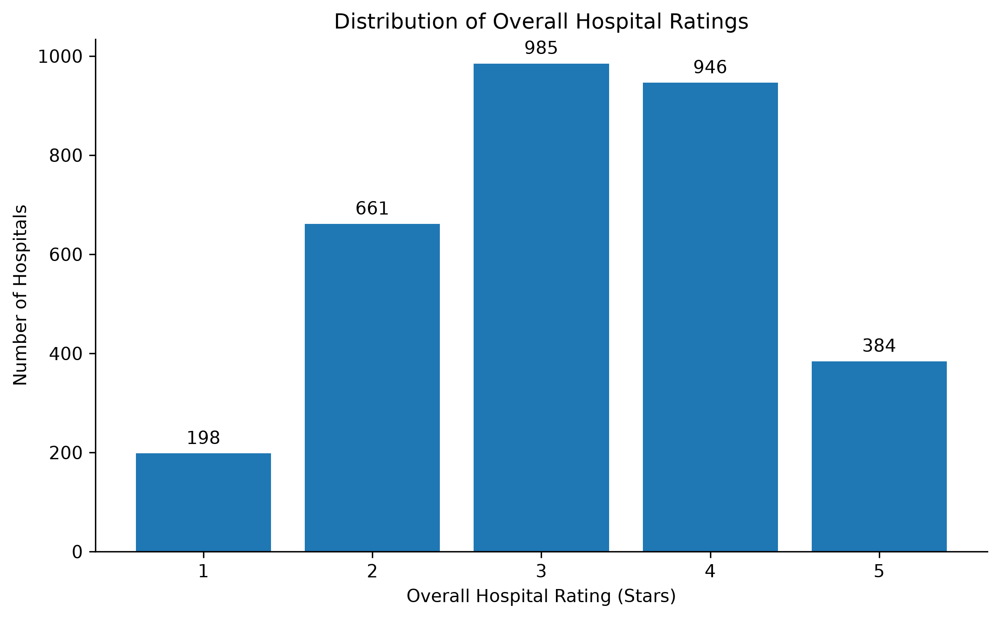
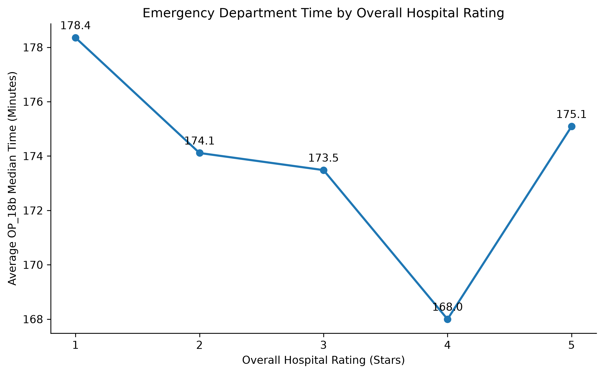
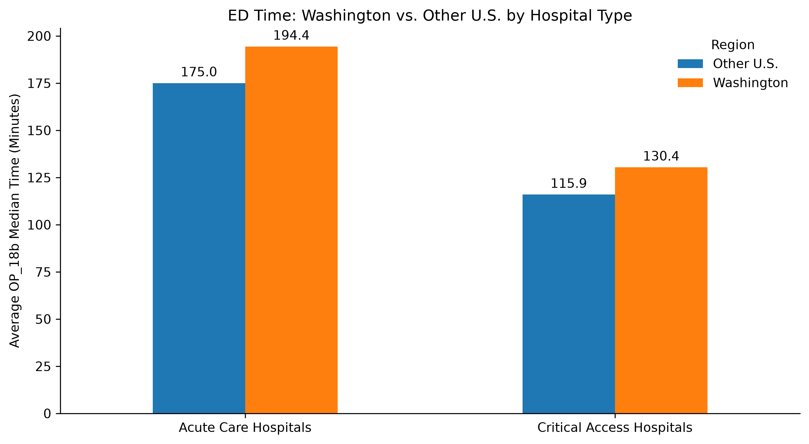
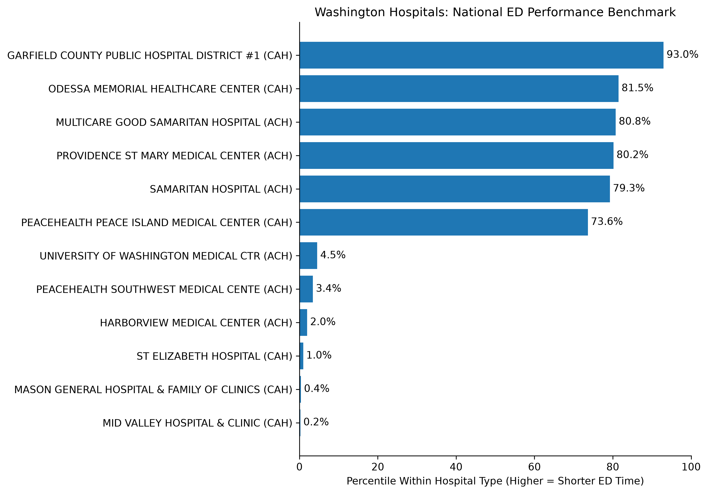

# U.S. Hospital Quality Analytics Pipeline

## Project Overview
As part of my Data Analytics journey, I built this project to analyze U.S. hospital quality data using public datasets from the Centers for Medicare & Medicaid Services (CMS). The project is an end-to-end analytics pipeline that takes raw data through cleaning and transformation using Python and Pandas, loads the processed data into a SQLite relational database, performs analysis using SQL, and produces visualizations with Python and Matplotlib. The analysis focuses on hospital characteristics, overall ratings, emergency department performance, and how Washington hospitals compare with national patterns. The goal is to build a reproducible workflow that connects data engineering, SQL analysis, and clear communication of analytical findings.

## Analytical Questions
1. How are U.S. hospitals distributed by characteristics such as hospital type, ownership, and overall rating?

2. How does the time patients spend in the emergency department vary across hospitals and overall hospital ratings?

3. How does emergency department performance in Washington State compare with hospitals nationally, including comparisons among similar hospital types?

4. How do individual Washington hospitals compare with similar hospitals nationally in emergency department performance?

## Data Sources
This project uses two public datasets from the Centers for Medicare & Medicaid Services (CMS):

- **Hospital General Information** — hospital characteristics including location, hospital type, ownership, emergency services, and overall hospital rating.
- **Timely and Effective Care – Hospital** — hospital-level quality measures covering areas including emergency department care, preventive care, and other measures of timely and effective care.

Source: CMS Provider Data Catalog.
https://data.cms.gov/provider-data/dataset/xubh-q36u
https://data.cms.gov/provider-data/dataset/yv7e-xc69

The raw CSV files used in the project are stored in `data/raw/` and are preserved separately from transformed data to maintain reproducibility and data lineage.

## Architecture
The project follows a reproducible pipeline from source data through analysis and visualization:

CMS Public Data
→ Raw CSV Files  
→ Python / Pandas ETL  
→ Processed Data  
→ SQLite Database  
→ SQL Analysis  
→ Python / Matplotlib Visualization  
→ Analytical Findings

## Technologies
- **Python** — data processing, analysis, and visualization
- **Pandas** — data cleaning, validation, and transformation
- **SQLite** — relational database
- **SQL** — querying, aggregation, joins, CTEs, and window functions
- **Matplotlib** — data visualization
- **Jupyter Notebook** — exploratory analysis and development
- **Git / GitHub** — version control and project documentation

## Data Pipeline
1. **Raw data** — CMS source files are preserved in `data/raw/`.
2. **Validation and transformation** — Python and Pandas are used to inspect, clean, validate, and transform the source data.
3. **Processed data** — Cleaned data is separated into three datasets: hospitals, measures, and hospital measures.
4. **Database build** — The processed datasets are loaded into SQLite as relational tables with primary and foreign key relationships.
5. **SQL analysis** — SQL queries analyze hospital characteristics, ratings, and emergency department performance, including Washington vs. national comparisons.
6. **Visualization** — Python and Matplotlib turn the analytical results into portfolio-ready visualizations.

## Data Model
The processed CMS data is organized into three relational tables:

- **`hospitals`** — one record per hospital, identified by `facility_id`, containing hospital characteristics and overall rating.
- **`measures`** — one record per CMS quality measure, identified by `measure_id`.
- **`hospital_measures`** — hospital-level measure results linking hospitals to quality measures, including reported scores, numeric scores, sample sizes, reporting periods, and footnotes.

Relationships:

`hospitals` → `hospital_measures` ← `measures`

The database contains:

- **5,419 hospitals**
- **30 quality measures**
- **138,084 hospital-measure records**

Primary and foreign key relationships were validated with zero foreign-key violations.

## Data Quality Decisions
The data was inspected and validated before being loaded into the relational database. Key decisions included:

- **Facility IDs** were standardized as six-character text values to support reliable joins between the CMS datasets.
- **Facility IDs were cross-validated** between the two source datasets before relational modeling.
- **CMS measure definitions** were validated against the source data, with particular attention to the emergency department measure used in the analysis.
- **OP_18b scores** were inspected and transformed into numeric values where possible while preserving the original reported values.
- **Sample values** were similarly converted to numeric values where possible while retaining the original values.
- **Reporting periods** were standardized to support consistent analysis across hospital measures.
- **Hospital overall ratings** were converted to a numeric representation for analysis while retaining the original rating field.
- **Missing or nonnumeric values were not automatically treated as errors.** Values such as "Not Available" can represent legitimate CMS reporting conditions and were preserved rather than arbitrarily imputed.
- **Relational integrity** was validated after database construction, including primary-key uniqueness and foreign-key relationships.

## Analysis
The analysis was performed using SQL against the SQLite relational database, with Python used for visualization and interpretation.

The analysis examined:

- Hospital distribution and characteristics
- Overall hospital ratings
- Emergency department performance
- The relationship between overall hospital ratings and emergency department performance
- Washington hospitals compared with national patterns
- Washington hospitals benchmarked against hospitals of the same type

SQL techniques included filtering, aggregation, grouping, joins, common table expressions (CTEs), and window functions. The analytical results were then visualized using Python and Matplotlib.

## Key Findings
- The dataset contains **5,419 hospitals**, of which **3,174 (58.6%)** have a numeric overall hospital rating.
- Among hospitals with numeric ratings, the average overall rating is **3.21 stars**.
- The selected emergency department measure had numeric scores for **4,081 hospitals**.
- The national average of hospital-level emergency department medians was **156.9 minutes**. Washington hospitals averaged **169.5 minutes**, compared with **156.7 minutes** for hospitals in the rest of the U.S.
- The Washington difference persisted when comparing hospitals within the same hospital type.
- Emergency department times generally decreased from 1-star through 4-star hospitals, while 5-star hospitals did not follow the same pattern.
- Benchmarking individual Washington hospitals against hospitals of the same type showed substantial variation within the state.

## Visualizations
### Overall Hospital Rating Distribution

Distribution of overall hospital ratings among hospitals with available numeric ratings.

### Emergency Department Time by Hospital Rating

Hospital-level median emergency department time across overall hospital rating categories.

### Washington vs. U.S. Emergency Department Performance

Comparison of emergency department performance between Washington hospitals and the rest of the U.S., separated by hospital type.

### Washington Hospital Benchmarking

Washington hospitals benchmarked against national hospitals of the same hospital type.

## Repository Structure
The project is organized into raw and processed data, analysis notebooks, visualization outputs, and project documentation.

cms-hospital-analytics/
├── data/
│   ├── raw/
│   └── processed/
├── notebooks/
├── outputs/
│   └── figures/
├── README.md
├── requirements.txt
└── .gitignore

## How to Run
1. Clone the repository.
2. Create and activate a Python virtual environment.
3. Install the required packages from `requirements.txt`.
4. Run the notebooks in order:
   - `01_data_validation.ipynb`
   - `02_build_database.ipynb`
   - `03_sql_analysis.ipynb`
   - `04_visualization.ipynb`

The raw CMS datasets should be placed in `data/raw/` before running the pipeline.

The complete notebook workflow was tested in the project's Python virtual environment and ran successfully from data validation through visualization.

## Limitations
- Emergency department performance represents one aspect of hospital performance, not overall hospital quality.
- Emergency department times are hospital-level medians, not patient-level average wait or treatment times.
- Overall hospital ratings are unavailable for a substantial portion of hospitals.
- Washington has a smaller hospital sample than the rest of the U.S.
- Differences between Washington and other hospitals are descriptive and do not establish causation.
- Hospital-type comparisons do not control for factors such as case mix, hospital size, geography, patient population, or available resources.

## Future Improvements

- Convert the notebook-based ETL into reusable Python scripts.
- Add automated data-quality tests.
- Expand the analysis to additional CMS quality measures.
- Add statistical analysis to examine relationships between hospital characteristics and quality measures.
- Extend the analysis with additional factors such as hospital size, geography, and patient population.